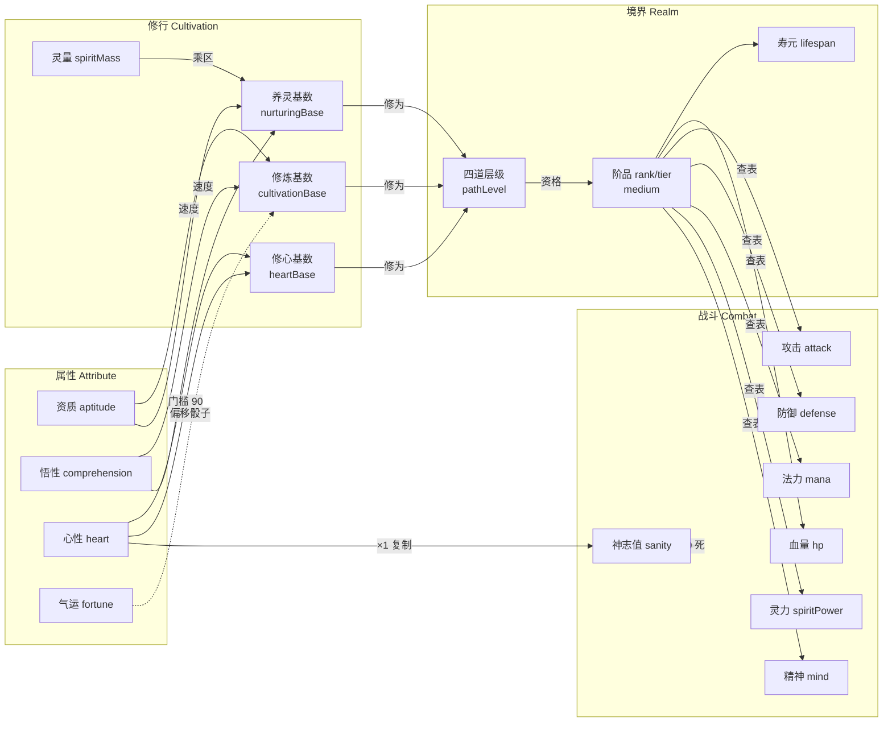
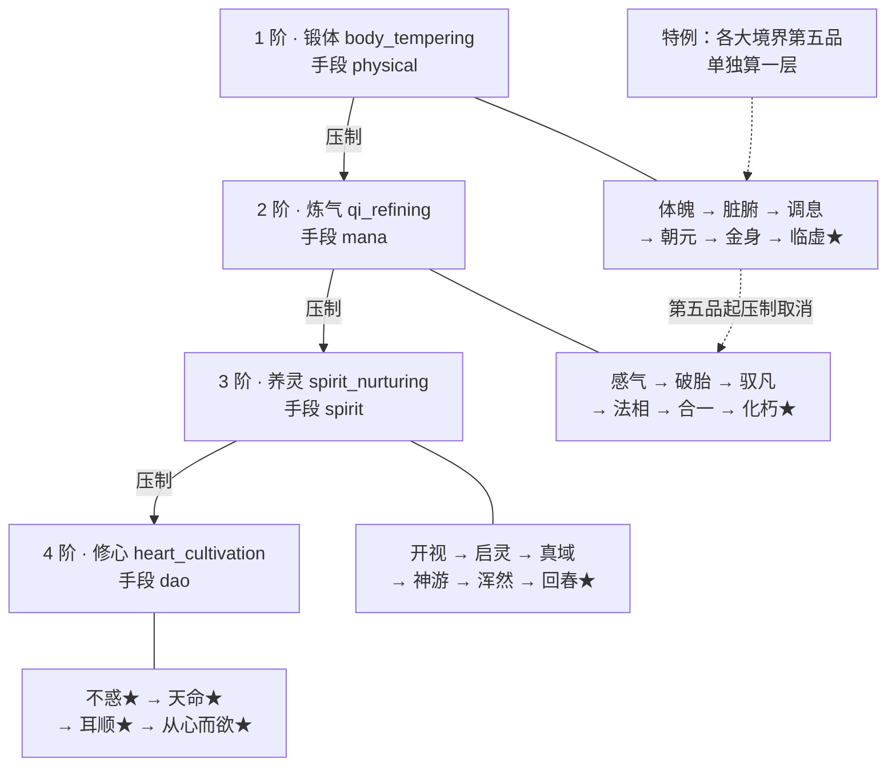
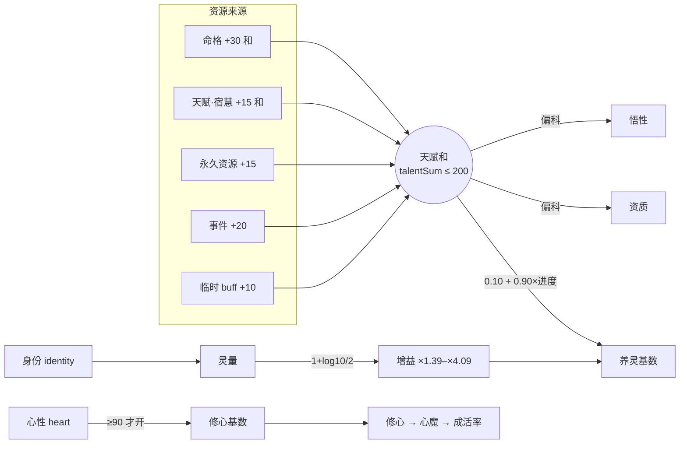
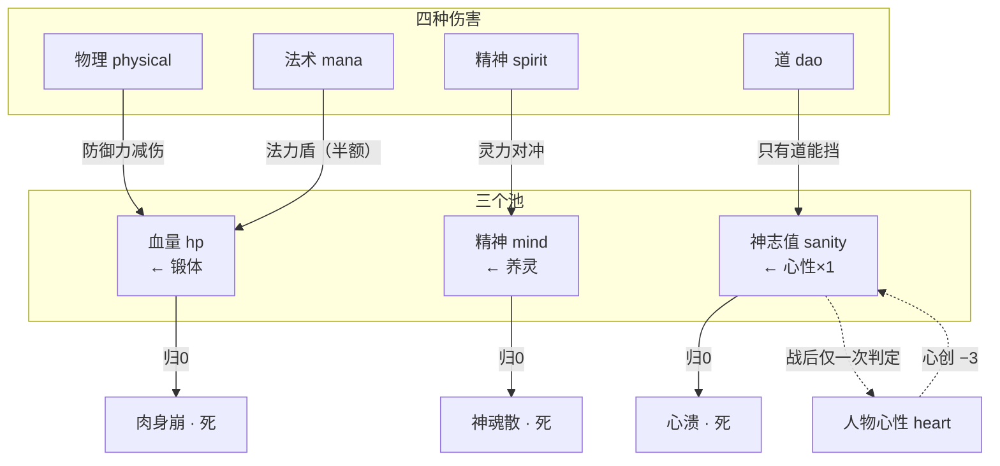
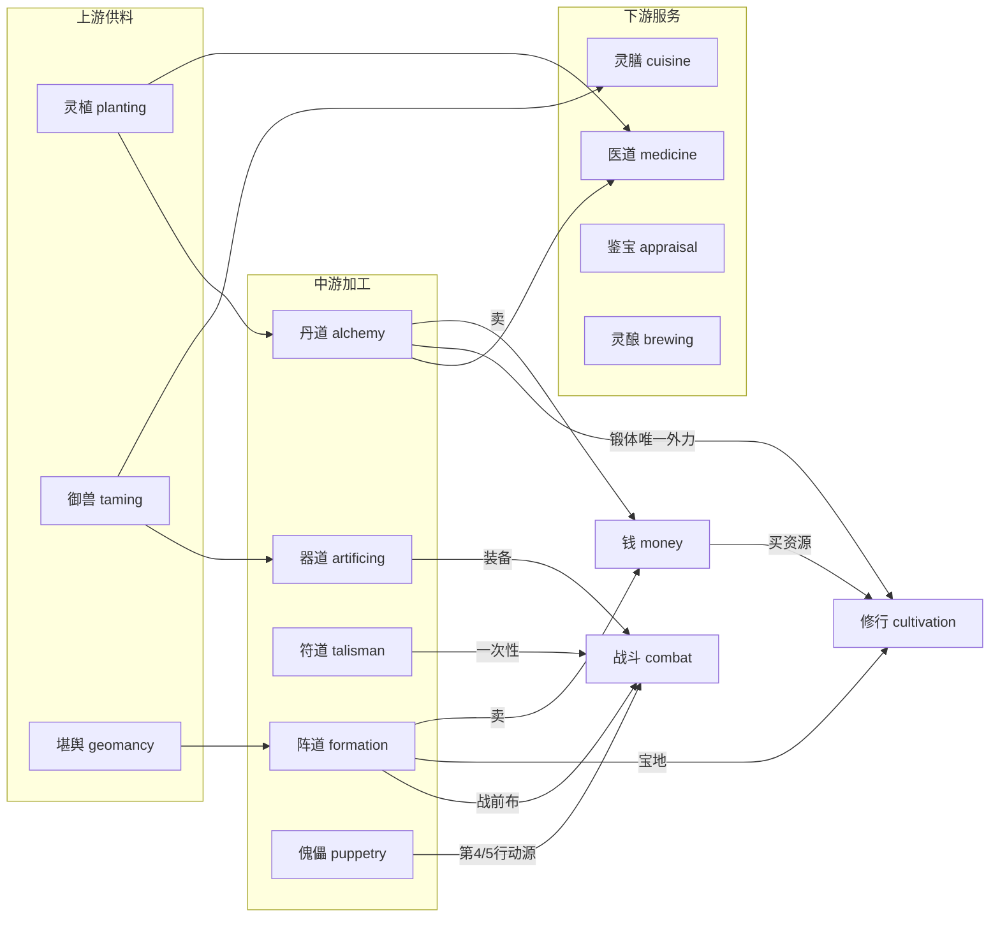
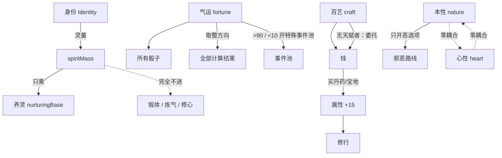

# 术语表与系统关系

> 建立：2026-10-29
> 定位：**全项目关键字的英文命名 + 分类映射 + 关系图**。任何代码、配置、事件脚本、文档引用，都以本表的标识符为准。
> 覆盖：境界 · 属性 · 修行 · 战斗 · 百艺 · 身份 · 气运事件 · 器物经济，共 **8 类 210 词**。
> 配套：`境界系统总纲.md`（境界权威）· `角色属性与规则系统.md`（属性权威）· `战斗系统总纲.md`（战斗权威）· `修真百艺.md`（百艺权威）· `世界人口与境界分布.md`（人口学后果）

---

## 0. 命名规范

### 0.1 四种标识符

| 用途 | 风格 | 示例 | 说明 |
|---|---|---|---|
| **常量** | `SCREAMING_SNAKE_CASE` | `HEART_GATE = 90` | 数值锚点、门槛、上限。**改它必须改文档** |
| **字段** | `camelCase` | `hidden.heart`、`spiritMass` | 存档结构、运行时对象 |
| **类型 / 枚举名** | `PascalCase` | `RealmPath`、`DamageType` | TS 类型、工厂函数 |
| **枚举值** | `lowercase_snake` | `'body_tempering'` | 字符串字面量，可序列化，不随重构变动 |

### 0.2 三条命名纪律

```text
1. 一词一义。同一个概念只有一个英文名，跨文档、跨代码不许有第二种写法。
2. 不翻译"境界专名"。锻体六品的六个名字是"名"，不是"概念"，
   用意象译（Viscera / Dharma Form），不用意译（Organ Refining）。
3. 数值单位进后缀。lifespanYears / ageYears / durationTurns，
   不许出现裸的 number 字段。
```

### 0.3 一个必须先解决的歧义

中文有三组"层"，英文必须分开：

| 中文 | 英文 | 标识符 | 是什么 |
|---|---|---|---|
| **阶 / 品** | Rank / Tier | `rank` / `tier` | 坐标：1 阶 3 品 = `{rank:1, tier:3}` |
| **四道层级** | Path Level | `pathLevel` | 每条道走到第几品（Lv0–6）。**破境的资格** |
| **手段层** | Medium | `medium` | 物理 / 法力 / 灵力 / 道。**决定谁能伤到谁** |

---

## 1. 分类总览

```text
                    ┌──────────────────────────────────────┐
                    │  G 气运与事件 Fortune & Event         │
                    │  事件的骰子；把"运气"翻译成"偏移"      │
                    └───────────────┬──────────────────────┘
                                    │ 修正
                                    ▼
   ┌──────────────┐   决定    ┌──────────────┐   产出   ┌──────────────┐
   │ B 属性        │─────────▶│ C 修行        │─────────▶│ A 境界        │
   │ Attribute    │           │ Cultivation  │           │ Realm        │
   │ 资质悟性心性  │◀─────────│ 基数/门槛/灵量 │           │ 四道×22品     │
   └──────▲───────┘   回写    └──────▲───────┘           └──────┬───────┘
          │                          │                          │ 决定面板
          │ 加成                     │ 乘区                     ▼
   ┌──────┴───────┐           ┌──────┴───────┐           ┌──────────────┐
   │ H 器物与经济  │           │ F 身份        │           │ D 战斗        │
   │ Item         │           │ Identity     │           │ Combat       │
   │ 丹药/宝地/钱  │           │ 灵量唯一乘区   │           │ 三血条四伤害   │
   └──────▲───────┘           └──────────────┘           └──────▲───────┘
          │ 产出                                                  │ 装备/丹药
          │                                                       │
   ┌──────┴───────────────────────────────────────────────────────┴───────┐
   │  E 百艺 Craft —— 赚钱 / 助修 / 战斗手段 / 治病救人（四个出口）          │
   └──────────────────────────────────────────────────────────────────────┘
```

**读法**：外圈是"输入与产出"，内圈是"转化链"。

```text
气运 → 定属性怎么分配
属性 → 定修行多快（基数）
修行 + 身份（灵量）→ 定能不能破境
境界 → 定战斗面板（血/法力/灵力/精神/攻/防）
身份 → 定灵量 → 只对养灵乘区生效（其余三道完全不看身份）
百艺 → 赚钱（买资源）→ 改属性 → 回到修行
器物 → 直接改属性/改战斗面板
```

---

## 2. A 类 · 境界 Realm

### 2.1 坐标与总纲

| 中文 | 英文 | 标识符 | 值域 |
|---|---|---|---|
| 境界 | Realm | `realm` | — |
| 大境界（阶） | Rank | `rank` | 1–4 |
| 小境界（品） | Tier | `tier` | 1–6（修心 1–4） |
| 四道 | Path | `path` | 见 2.2 |
| 极境 | Paragon | `paragon` | boolean |
| 世界认可 | World Recognition | `worldRecognition` | boolean（三道各一次） |
| 悟道 | Dao Enlightenment | `daoEnlightenment` | boolean（第六品资格） |
| 手段层 | Medium | `medium` | `physical` / `mana` / `spirit` / `dao` |
| 四道层级 | Path Level | `pathLevel` | 0–6（修心 0–4） |

> **`paragon` 为什么不用 `apex`**：`apex` 在别处指"峰值/顶点"（如 `apexSpeed`），会混。`paragon` 专指"七个极境"这个布尔资格。

### 2.2 四道

| 中文 | 英文 | 标识符 | Rank | 手段层 | 主属性 |
|---|---|---|---|---|---|
| 锻体 | Body Tempering | `body_tempering` | 1 | `physical` | 资质 |
| 炼气 | Qi Refining | `qi_refining` | 2 | `mana` | 悟性 |
| 养灵 | Spirit Nurturing | `spirit_nurturing` | 3 | `spirit` | 资质+悟性之和 |
| 修心 | Heart Cultivation | `heart_cultivation` | 4 | `dao` | 心性 |

> **`spirit_nurturing` 与 `spirit` 不冲突**：前者是"道"（一个字符串枚举），后者是"手段层"（另一个枚举）。字段永不混用：`realm.path === 'spirit_nurturing'`，`realm.medium === 'spirit'`。

### 2.3 二十二小境界

| 阶 | 品 | 中文 | 英文 | 标识符 |
|---|---|---|---|---|
| 1 | 1 | 体魄 | Physique | `physique` |
| 1 | 2 | 脏腑 | Viscera | `viscera` |
| 1 | 3 | 调息 | Breath Regulation | `breath_regulation` |
| 1 | 4 | 朝元 | Origin Return | `origin_return` |
| 1 | 5 | 金身 | Golden Body | `golden_body` |
| 1 | 6 | 临虚 ★ | Void Approach | `void_approach` |
| 2 | 1 | 感气 | Qi Sense | `qi_sense` |
| 2 | 2 | 破胎 | Embryo Break | `embryo_break` |
| 2 | 3 | 驭凡 | Mortal Mastery | `mortal_mastery` |
| 2 | 4 | 法相 | Dharma Form | `dharma_form` |
| 2 | 5 | 合一 | Unity | `unity` |
| 2 | 6 | 化朽 ★ | Decay Transcendence | `decay_transcendence` |
| 3 | 1 | 开视 | Spirit Sight | `spirit_sight` |
| 3 | 2 | 启灵 | Spirit Awakening | `spirit_awakening` |
| 3 | 3 | 真域 | True Domain | `true_domain` |
| 3 | 4 | 神游 | Spirit Wandering | `spirit_wandering` |
| 3 | 5 | 浑然 | Undivided Whole | `undivided_whole` |
| 3 | 6 | 回春 ★ | Rejuvenation | `rejuvenation` |
| 4 | 1 | 不惑 ★ | No Doubt | `no_doubt` |
| 4 | 2 | 天命 ★ | Heaven's Mandate | `heavens_mandate` |
| 4 | 3 | 耳顺 ★ | Attuned Ear | `attuned_ear` |
| 4 | 4 | 从心而欲 ★ | Heart's Desire | `hearts_desire` |

### 2.4 破境相关

| 中文 | 英文 | 标识符 | 说明 |
|---|---|---|---|
| 瓶颈 | Bottleneck | `bottleneck` | 需不需要"改层级" |
| 破境 | Breakthrough | `breakthrough` | 四步判定的总称 |
| 层级判定 | Layer Roll | `layerRoll` | 一次骰子，命中则 `pathLevel += 1` |
| 概率 | Break Chance | `breakChance` | p |
| 失败代价 | Failure Cost | `failureCost` | 锻体炼气不扣修为；养灵 −10%；修心 −10×基数 |
| 灌顶 | Empowerment | `empowerment` | 借他人之悟，p +0.25，心性 −6 |
| 压制 | Suppression | `suppression` | 跨境界 `p' = 1−(1−p)×0.1` |

### 2.5 寿命与极境

| 中文 | 英文 | 标识符 |
|---|---|---|
| 寿元 | Lifespan | `lifespan` |
| 剩余寿元 | Remaining Lifespan | `lifespanRemaining` |
| 续命（延寿） | Life Extension | `lifeExtension` |
| 延寿丹 | Life Pill | `lifePill` |
| 返老 | Rejuvenate | `rejuvenate` |
| 转世重修 | Reincarnation | `reincarnation` |
| 天劫 | Tribulation | `tribulation` |

---

## 3. B 类 · 属性 Attribute

### 3.1 五个底层属性

| 中文 | 英文 | 标识符 | 值域 | 一句话 |
|---|---|---|---|---|
| 资质 | Aptitude | `aptitude` | 30–100 | 锻体的唯一出口 |
| 悟性 | Comprehension | `comprehension` | 30–100 | 炼气的唯一出口 |
| 心性 | Heart | `heart` | 0–100 | 修心的门槛；出生 80–90，衰减地板 60 |
| 本性 | Nature | `nature` | 0–100 | 善恶倾向，与心性**零耦合** |
| 气运 | Fortune | `fortune` | 0–100 | 只修正随机质量与取整方向 |

### 3.2 派生量

| 中文 | 英文 | 标识符 | 公式 |
|---|---|---|---|
| 天赋和 | Talent Sum | `talentSum` | `aptitude + comprehension`，硬顶 **200** |
| 属性上限 | Cap | `cap` | 单项 100 |
| 心性门槛 | Heart Gate | `HEART_GATE` | **90** |
| 心性衰减地板 | Heart Floor | `HEART_FLOOR` | **60** |
| 心性危险线 | Heart Danger | `HEART_DANGER` | **40** |
| 心性必触发线 | Heart Force | `HEART_FORCE` | **20** |
| 出生心性 | Heart at Birth | `HEART_BIRTH` | **80–90** |

### 3.3 三种值（结算模型）

| 中文 | 英文 | 标识符 | 存不存 |
|---|---|---|---|
| 底值 | Base Value | `base` | 存 |
| 表现值 | Effective Value | `effective` | 不存，读时走链 |
| 中间值 | Intermediate Value | `intermediate` | 存当前值，事件回写 |

### 3.4 修正类型

| 中文 | 英文 | 标识符 | 说明 |
|---|---|---|---|
| 加成 | Bonus | `bonus` | 加数 |
| 乘区 | Multiplier | `multiplier` | 乘数 |
| 覆盖 | Override | `override` | 直接替换 |
| 抵消 | Negate | `negate` | 删条目或使其失效 |
| 临时增益 | Temporary Buff | `tempBuff` | 带 `expireAge` |

---

## 4. C 类 · 修行 Cultivation

### 4.1 三个基数

| 中文 | 英文 | 标识符 | 谁用 |
|---|---|---|---|
| 修炼基数 | Cultivation Base | `cultivationBase` | 锻体、炼气 |
| 养灵基数 | Nurturing Base | `nurturingBase` | 养灵 |
| 修心基数 | Heart Base | `heartBase` | 修心 |
| 百艺基数 | Craft Base | `craftBase` | 十二门 |

```text
NURTURING_BASE = 0.10 + 0.90 × clamp((talentSum − 160) / 40, 0, 1)
HEART_BASE     = 0.10 + 0.90 × clamp((heart − 90) / 10, 0, 1)      // heart < 90 → 0
```

> **`0.90` 只乘进度，不乘 `0.10` 起手值**。误写成 `0.90 × (0.10 + sum − 160) / 40` 会得到 0.00225，把百年的路做成两千四百年。

### 4.2 修为与进度

| 中文 | 英文 | 标识符 | 说明 |
|---|---|---|---|
| 修为 | Cultivation Progress | `cultivation` | 绝对值，每道一份 |
| 修为上限 | Progress Cap | `progressCap` | 锻体 5,400 起 |
| 月修为 | Monthly Gain | `monthlyGain` | `基数 × 20 × 乘区` |
| 静修 | Meditation | `meditation` | 基础行动 |
| 闭关 | Seclusion | `seclusion` | 数十年一次的长跨度行动 |
| 云游 | Wandering | `wandering` | 攒门间隔 |
| 顿悟 | Insight | `insight` | 8–12 年 |

### 4.3 灵量（身份的出口）

| 中文 | 英文 | 标识符 | 说明 |
|---|---|---|---|
| 灵量 | Spirit Mass | `spiritMass` | **只对养灵生效** |
| 境界权重 | Realm Weight | `realmWeight` | 凡人 0.2 / 锻体 1 / 炼气 2 / 养灵 5 / 修心 8 |
| 灵量增益 | Spirit Gain | `spiritGain` | `1 + log10(spiritMass + 1) / 2` |
| 治下生灵 | Subjects | `subjects` | 人口，向基线回归 |

```text
spiritMass = Σ (count × realmWeight)
spiritGain = 1 + log10(spiritMass + 1) / 2
```

> **为什么用 log**：让"城主 ×4.09"与"散修 ×1.39"差 2.9 倍而非 100 倍——**身份是护城河，不是天堑**。副作用是**对人口构成极不敏感**（100 万人全是凡人还是半修士，增益只差 0.09），所以修士比例可以自由设定。

### 4.4 心性的四条线

| 中文 | 英文 | 标识符 | 机制 |
|---|---|---|---|
| 自然衰减 | Natural Decay | `heartDecay` | 在校 −1/年、离校 −2/年，地板 60 |
| 事件作用 | Event Shift | `heartShift` | 不受地板约束，可压到 0 |
| 心魔 | Heart Demon | `heartDemon` | <40 概率、≤20 必触发 |
| 心魔成活 | Survival | `demonSurvival` | `0.10 × heart / 39`（越低越必死） |

> **`demonSurvival` 必须是正比**。写成 `3.9 / heart` 会让心性 0 的人"必活"，与"越低越必死"完全相反。

---

## 5. D 类 · 战斗 Combat

### 5.1 三条血条

| 中文 | 英文 | 标识符 | 来源 | 归零 |
|---|---|---|---|---|
| 血量 | Health | `hp` | 锻体 | 肉身崩 |
| 精神 | Mind | `mind` | 养灵 | 神魂散 |
| 神志值 | Sanity | `sanity` | `heart × 1`（进场复制） | 道心碎（心溃） |

> **`sanity` 与 `heart` 必须分字段**。`sanity` 是临时的命（打完即弃），`heart` 是一辈子的数（归 0 走心魔）。用同一个字段会让"心性 0 当场死"，修心者就成了全游戏最脆的人。

### 5.2 其余四项

| 中文 | 英文 | 标识符 | 来源 |
|---|---|---|---|
| 法力 | Mana | `mana` | 炼气 |
| 灵力 | Spirit Power | `spiritPower` | 养灵 |
| 攻击力 | Attack | `attack` | 锻体 |
| 防御力 | Defense | `defense` | 锻体 |

### 5.3 四种伤害

| 中文 | 英文 | 标识符 | 扣 | 谁能挡 |
|---|---|---|---|---|
| 物理伤害 | Physical Damage | `physical` | `hp` | 防御力；法力盾（1:2） |
| 法术伤害 | Mana Damage | `mana` | `hp` | 法力盾（纯法力全额、灵力术法段半额）；**防御力无效** |
| 精神伤害 | Spirit Damage | `spirit` | `mind` | **只有灵力对冲** |
| 道伤 | Dao Damage | `dao` | `sanity` | **只有道** |

### 5.4 术法与功法

| 中文 | 英文 | 标识符 | 说明 |
|---|---|---|---|
| 术法 | Art | `art` | 战斗招式，93 条 |
| 功法 | Method | `method` | 修炼倍率 |
| 品阶 | Grade | `grade` | 天地玄黄 |
| 熟练度 | Mastery | `mastery` | `novice` / `adept` / `perfected` |
| 相性 | Affinity | `affinity` | 五行/阴阳 |
| 副作用 | Backlash | `backlash` | 反噬 |

| 天地玄黄 | 英文 | 标识符 |
|---|---|---|
| 天阶 | Heaven Grade | `heaven` |
| 地阶 | Earth Grade | `earth` |
| 玄阶 | Mystic Grade | `mystic` |
| 黄阶 | Profound Grade | `profound` |

### 5.5 器物四档（战斗侧）

| 中文 | 英文 | 标识符 |
|---|---|---|
| 凡器 | Mortal Armament | `mortal` |
| 法器 | Artifact | `artifact` |
| 灵器 | Spirit Armament | `spirit_armament` |
| 传承器 | Heirloom | `heirloom` |

### 5.6 战斗流程

| 中文 | 英文 | 标识符 |
|---|---|---|
| 回合 | Turn | `turn` |
| 先手 | Initiative | `initiative` |
| 危险线 | Danger Line | `dangerLine`（任意血条 ≤10% 可叫停） |
| 生死斗 | Death Match | `deathMatch` |
| 认输 | Yield | `yield` |
| 遁走 | Flee | `flee` |
| 极境战 | Paragon Duel | `paragonDuel` |
| 战后伤病 | Post-battle Injury | `injury` |

---

## 6. E 类 · 百艺 Craft

### 6.1 十二门 + 三禁

| 中文 | 英文 | 标识符 | 入门阶 |
|---|---|---|---|
| 丹道 | Alchemy | `alchemy` | 1 |
| 器道 | Artificing | `artificing` | 1 |
| 符道 | Talisman Craft | `talisman` | 2 |
| 阵道 | Formation Craft | `formation` | 2 |
| 灵植 | Spirit Planting | `planting` | 1 |
| 御兽 | Beast Taming | `taming` | 1 |
| 傀儡 | Puppetry | `puppetry` | 2 |
| 医道 | Medicine | `medicine` | 1 |
| 灵膳 | Spirit Cuisine | `cuisine` | 1 |
| 堪舆 | Geomancy | `geomancy` | 2 |
| 鉴宝 | Appraisal | `appraisal` | 1 |
| 灵酿 | Brewing | `brewing` | 1 |
| 禁·血丹 | Blood Alchemy | `blood_alchemy` | 1 |
| 禁·炼魂 | Soul Forging | `soul_forging` | 2 |
| 禁·蛊 | Gu Sorcery | `gu_sorcery` | 1 |

### 6.2 品阶与天赋

| 中文 | 英文 | 标识符 | 值域 |
|---|---|---|---|
| 百艺品阶 | Craft Tier | `craftTier` | 1–3 阶（师 4–5 阶不开放） |
| 百艺积累 | Craft Progress | `craftProgress` | 按阶跳 |
| 天赋 | Talent | `talent` | `none` / `minor` / `major` |
| 卓绝 | Major Talent | `major` | 可越一阶 |
| 委托 | Commission | `commission` | 无天赋者的活路 |

### 6.3 四个功能出口

| 出口 | 英文 | 标识符 | 代表门 |
|---|---|---|---|
| 赚钱 | Income | `income` | 丹道、阵道、器道 |
| 助修 | Cultivation Aid | `cultivationAid` | 丹道（锻体）、阵道（宝地）、器道（养宝） |
| 战斗手段 | Combat Supply | `combatSupply` | 符道、器道、丹药 |
| 治病救人 | Healing | `healing` | 医道 |

---

## 7. F 类 · 身份 Identity

| 中文 | 英文 | 标识符 | 灵量 | 强制事件 |
|---|---|---|---|---|
| 城主 | City Lord | `city_lord` | 50 万–150 万 | 朝会、赈灾 |
| 将军 | General | `general` | 2 万–20 万 | **出征（必去）** |
| 宗门宗主 | Sect Master | `sect_master` | 2,000–2 万 | 护山、调解 |
| 家主 | Clan Head | `clan_head` | 100–1,000 | 族中事务 |
| 附庸（有实职） | Retainer | `retainer` | 按职务 | 主公差遣 |
| 城卫 | City Guard | `city_guard` | 数十–数百 | 城防调动 |
| 城中居民 | Resident | `resident` | 个位数 | 缴税 |
| 太学生 | Academy Student | `academy_student` | 个位数 | 季考 |
| 宗门弟子 | Sect Disciple | `sect_disciple` | **0** | 差遣 |
| 散修 / 种草者 | Rogue | `rogue` | 5–50 | 无 |
| 邪修 | Heretic | `heretic` | 掠夺 | 仙司围剿 |

### 7.1 学籍

| 中文 | 英文 | 标识符 |
|---|---|---|
| 蒙学 | Primary Academy | `primary` |
| 府学 | Prefectural Academy | `prefectural` |
| 太学 | Imperial Academy | `imperial` |
| 卒业 | Graduated | `graduated` |
| 肄业 | Withdrawn | `withdrawn` |

### 7.2 位置

| 中文 | 英文 | 标识符 |
|---|---|---|
| 城中 | In City | `in_city` |
| 野外 | Wilderness | `wilderness` |
| 路上 | On Road | `on_road` |
| 秘境 | Secret Realm | `secret_realm` |
| 在校 | At Academy | `at_academy` |

---

## 8. G 类 · 气运与事件 Fortune & Event

### 8.1 气运档位

| 中文 | 英文 | 标识符 | 区间 |
|---|---|---|---|
| 绝境 | Doomed | `doomed` | 0 |
| 倒霉 | Ill-Fated | `ill_fated` | 1–9 |
| 差 | Poor | `poor` | 10–19 |
| 正常 | Normal | `normal` | 20–80 |
| 好 | Good | `good` | 81–90 |
| 强运 | Blessed | `blessed` | 91–100 |

### 8.2 事件结构

| 中文 | 英文 | 标识符 |
|---|---|---|
| 事件 | Event | `event` |
| 事件池 | Event Pool | `eventPool` |
| 条件 | Condition | `condition` |
| 选项 | Choice | `choice` |
| 效果 | Effect | `effect` |
| 权重 | Weight | `weight` |
| 轮播事件 | Passive Event | `passiveEvent` |
| 事件链 | Event Chain | `eventChain` |
| 一次性 | Once | `once` |

---

## 9. H 类 · 器物与经济 Item & Economy

| 中文 | 英文 | 标识符 |
|---|---|---|
| 钱 | Money | `money` |
| 物品 | Item | `item` |
| 装备 | Equipment | `equipment` |
| 丹药 | Pill | `pill` |
| 宝地 | Spirit Site | `spiritSite` |
| 灵脉 | Spirit Vein | `spiritVein` |
| 阵盘 | Formation Plate | `formationPlate` |
| 符箓 | Talisman | `talismanItem` |
| 傀儡 | Puppet | `puppet` |
| 战兽 | War Beast | `warBeast` |
| 药浴 | Medicinal Bath | `medicinalBath` |
| 洗髓 | Marrow Cleansing | `marrowCleansing` |

### 9.1 永久资源（改属性）

| 资源 | 上限 | 加什么 | 价 |
|---|---|---|---|
| 药浴 | +3 | 资质 | 3 金 |
| 洗髓 / 大洗髓 | +3 / +6（互斥） | 资质 | 5 / 20 金 |
| 宝物三件 | 合计 +6 | 悟性 | 22 金 |
| **合计** | **+15** | — | **49 金** |

---

## 10. 关系图

### 10.1 主链：属性 → 修行 → 境界 → 战斗



**这张图的三条硬边界**：

```text
① 属性不进战斗面板（唯一例外：heart → sanity）
② 境界只查表，没有"资历累积"
③ 灵量只乘养灵，其余三道完全不吃身份
```

### 10.2 境界内部：四道 × 阶品 × 手段层



### 10.3 修行内部：三个基数 × 四类资源



### 10.4 战斗内部：三血条 × 四伤害



### 10.5 百艺内部：十二门 × 四个出口



### 10.6 跨链：三条容易被忽略的"外挂线"



> **`nature` ↔ `heart` 必须是虚线**。这两条属性在机制上没有任何传递：屠城不动心性（除非他自己因此怀疑），心性 30 不阻止行善。任何把它们连起来的实线，都是把"心魔"重新变成"报应"。

---

## 11. 弃用与冲突

### 11.1 已废弃的旧标识符

| 旧 | 新 | 原因 |
|---|---|---|
| `combatheart` / `battleHeart` | `sanity` | r12 改名"神志值"，避免与人物心性混 |
| `heartDefense`（心防 = heart×2） | `sanity`（= heart×1） | 旧倍率作废 |
| `insight`（认知） | `pathLevel` | 改用层级 Lv |
| `enlightenment`（明悟） | `pathLevel` | 同上 |
| `opportunity`（机缘） | `pathLevel`（法相 = Lv4） | 布尔改层级 |
| `spiritField`（灵田） | `spiritSite`（宝地） | 灵田不存在，是"地点"不是"资产" |
| `merit`（功德） | — | 不存在善恶积分 |
| `favor`（人情） | — | 收敛为 `reputation` + 身份 |
| `warped` / `cognition`（生命层级） | `spirit_nurturing` 的 `pathLevel` | 统一进层级 |

### 11.2 三个高频混淆点

| 容易混 | 区别 |
|---|---|
| `spirit_nurturing`（道）vs `spirit`（手段层）vs `spiritPower`（灵力池） | 三个字段，永不互用 |
| `heart`（人物心性）vs `sanity`（神志值） | 前者一辈子，后者一场仗 |
| `pathLevel`（四道层级）vs `tier`（小境界序号） | 前者是"门票"，后者是"坐标"。正常情况下相等，但**可以超前攒** |

### 11.3 字段名速查（存档结构）

```js
{
  hidden: { aptitude, comprehension, heart, nature, fortune },   // B 类
  realm:  { path, rank, tier, medium, paragon, pathLevel },      // A 类
  cultivation: { body: 0, qi: 0, spirit: 0, heart: 0 },          // C 类
  lifespan, age, lifespanRemaining,                              // A 类
  identity: { kind, subjects, spiritMass, spiritGain },           // F 类
  combat: { hp, mana, spiritPower, mind, sanity, attack, defense }, // D 类
  craft: { alchemy: {tier, progress, talent}, ... },             // E 类
  money, items, equipment, spiritSite,                           // H 类
  location, enrollment,                                          // F 类
}
```

---

## 12. 与既有文档的关系

| 本表分类 | 权威文档 | 本表只做什么 |
|---|---|---|
| A 境界 | `境界系统总纲.md` | 给英文名，不重定义门槛 |
| B 属性 | `角色属性与规则系统.md` §5 | 给英文名，不重定义公式 |
| C 修行 | `角色属性与规则系统.md` §5.9、`境界系统总纲.md` §5.2 | 同上 |
| D 战斗 | `战斗系统总纲.md` §4–§8 | 同上 |
| E 百艺 | `修真百艺.md` | 同上 |
| F 身份 | `身份系统.md` | 同上 |
| G 事件 | `事件系统重构.md`、`气运系统.md` | 同上 |
| H 经济 | `经济与物价.md`、`修真百艺.md` §5 | 同上 |

**规则**：本表与权威文档冲突时，**以权威文档的数值为准，以本表的命名为准**。
