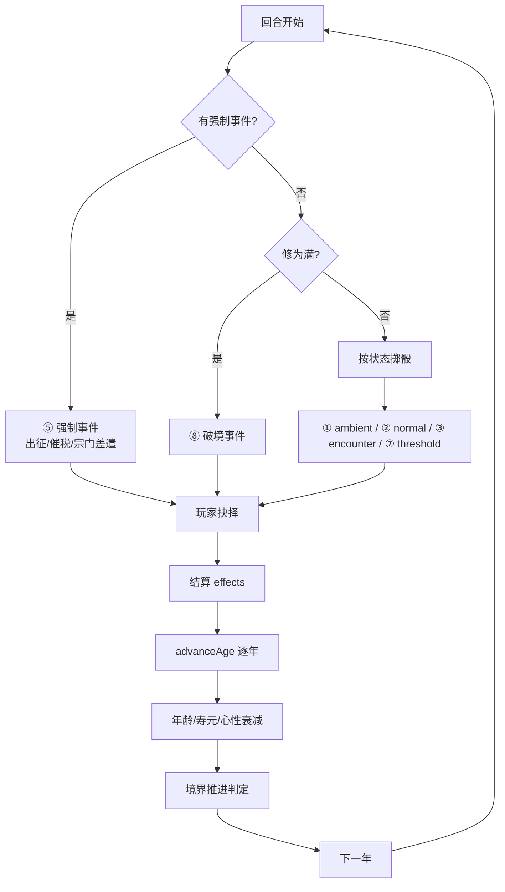
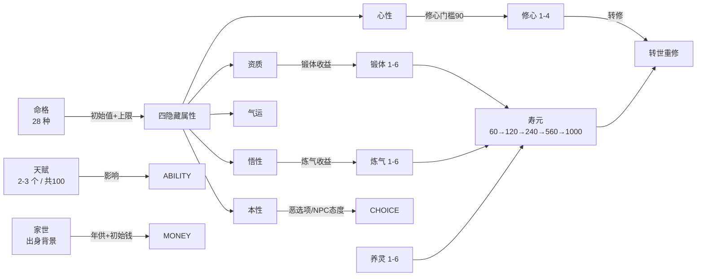
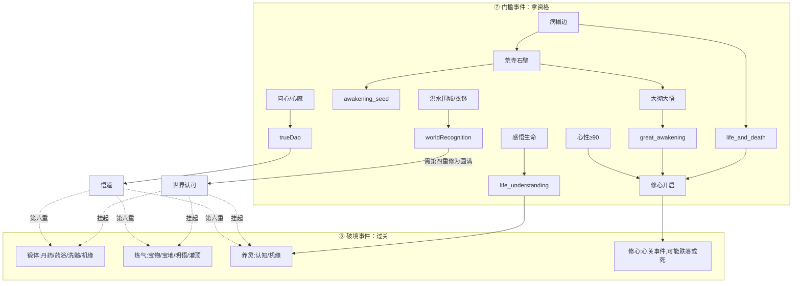
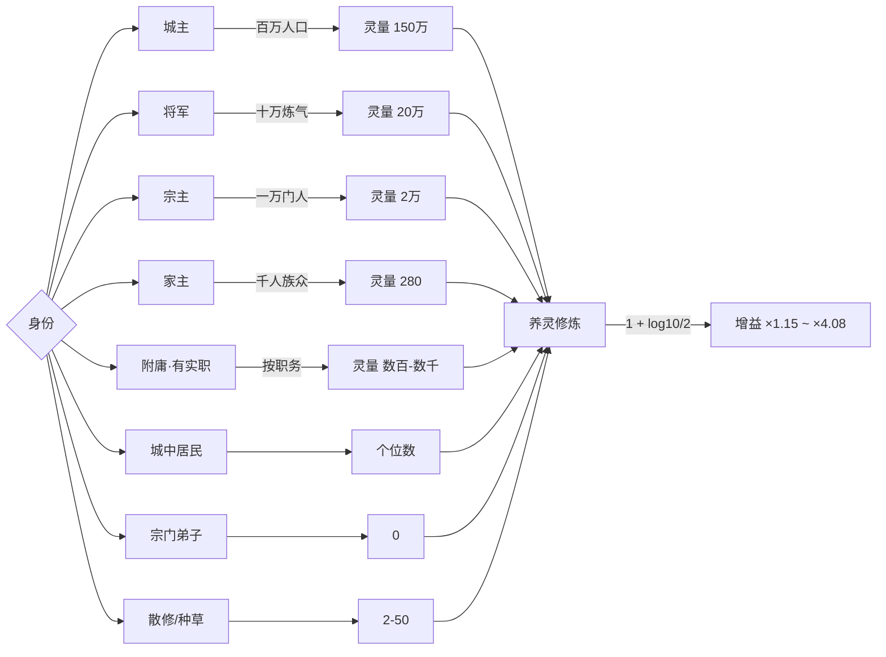
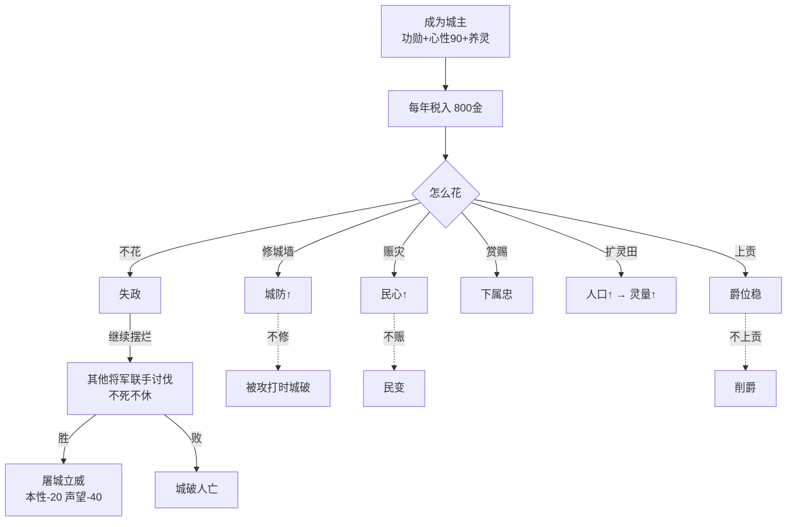
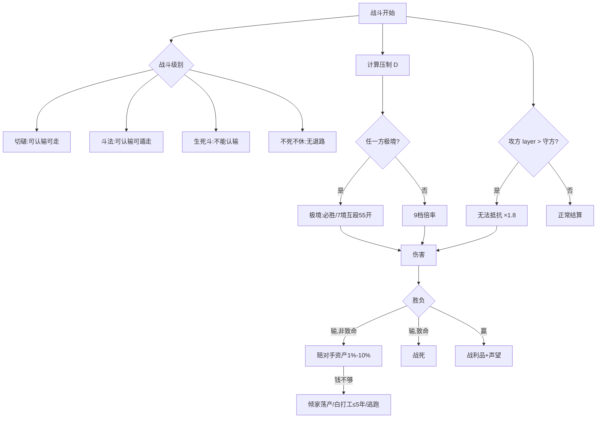
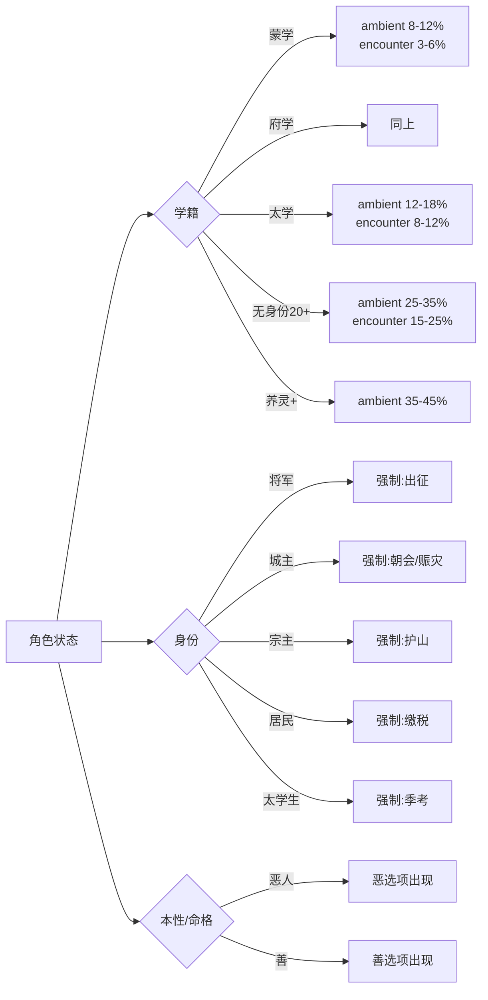
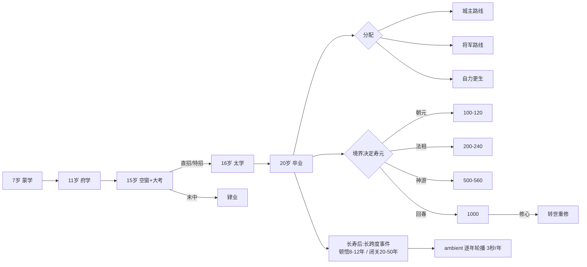

# 系统关系图（Mermaid）

> ⚠️ **本页术语已过期（2026-10-29）**：图中的 `INS 悟性`、`LCK 气运`、`生命层级`、`心防` 等旧名，已被 [`术语表与系统关系.md`](术语表与系统关系.md) 取代（`comprehension` / `fortune` / `pathLevel` / `sanity`）。
> **看图看本页，查名查新表**。本页保留是因为它画的是"回合流程"（新表不重复画流程）。
> 用途：一页看清各方关系。改设定时先看这里，避免“改了钱但忘了税”。
> 配套：[身份系统](身份系统.md) · [经济与物价](经济与物价.md) · [境界改造计划](境界改造计划.md) · [事件系统重构](事件系统重构.md) · [战斗系统改造计划](战斗系统改造计划.md)

---

## 1. 总览：一个回合里发生了什么



---

## 2. 角色 · 属性 · 命格



---

## 3. 境界 · 门槛 · 破境（三层关系）



---

## 4. 身份 · 灵量 · 养灵



---

## 5. 金钱闭环

```mermaid
flowchart TD
    subgraph IN[收入]
        I1[打工/委托]
        I2[家世供给 1金→50银→20银]
        I3[俸禄 + 治下抽成]
        I4[奇遇/战利品]
        I5[杀人掉宝+黑市]
    end

    IN --> PURSE[钱袋]

    PURSE --> subgraph OUT[支出]
        O1[生存:住/吃]
        O2[修炼开销]
        O3[百艺材料]
        O4[装备/丹药]
        O5[破境:宝物/灌顶]
        O6[身份开销]
    end

    O3 -->|炼丹需灵草| CRAFT[百艺进度]
    O5 -->|花钱破境| REALM[境界提升]
    O6 -->|修城墙/赈灾/上贡| CITY[城防/民心/忠诚]
    CITY --> SUBJ[灵量]
    SUBJ --> SPIRITGAIN[养灵收益]
    REALM --> IDENTITY[身份晋升]
    IDENTITY --> I3
```

---

## 6. 城主：钱、权、生死



---

## 7. 战斗：压制 · 代差 · 分级



---

## 8. 事件抽取与角色状态



---

## 9. 时间 · 年龄 · 寿元



---

## 10. 数据依赖总表

| 数据 | 影响 | 被谁改 |
| --- | --- | --- |
| `age` | 事件门槛、寿元、心性衰减、大考、家世档位 | 每年 +years |
| `hidden.aptitude` | 锻体收益/瓶颈、直招、战斗 | 命格/事件 |
| `hidden.insight` | 炼气收益/瓶颈、直招、宝地、灵器 | 命格/事件/宝物buff |
| `hidden.heart` | **只影响修心门槛(90)与突破** | 大彻大悟/心魔/灌顶 |
| `hidden.nature` | 恶选项、NPC 态度、事件分支 | 善恶选择 |
| `hidden.luck` | 突破率、判定、掉落 | 命格/事件 |
| `merit` | 身份晋升、大考评分 | 委托/战功/救人 |
| `reputation` | 直招、晋升、报酬、借宝、物价、招附庸 | 战斗/委托/恶行 |
| `subjects` | 养灵修为（灵量 = Σ人数×权重） | 身份/人口/战乱 |
| `money` | 生存/修炼/百艺/装备/破境/身份开销/赔偿 | 收入支出 |
| `years` | 年龄、寿元、事件跨度 | 玩家选择 |
| `fate` | 四属性初始/上限、初始本性、天赋权重 | 开局/转修 |
| `talents` | 百艺上限、修炼倍率、战斗特性 | 开局/奇遇 |
| `family` | 家世档位 → 年供、成年断供 | 开局/贡献 |

---

## 11. 一眼看懂的三条主线

**主线一：资质决定你能不能修**
命格 → 资质/悟性 → 锻体/炼气收益 → 能不能赶在 15 岁前破胎 → 进不进太学 → 有没有资格碰养灵。

**主线二：身份决定你修得快不快**
身份 → 灵量 → 养灵增益（×1.15 ~ ×4.08）→ 能不能在有生之年到第六重。

**主线三：钱决定你能走多远**
家世/委托/俸禄 → 钱 → 修炼材料 + 百艺 + 破境 + 装备 → 境界/战力 → 更高身份 → 更多钱。
